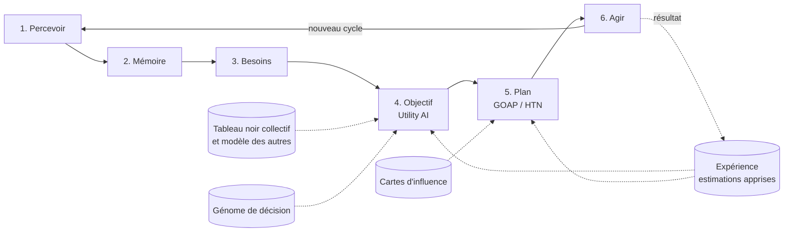

# 06 — Moteur comportemental

Le choix graphique minimal du jeu (1 pixel = 1 unité) a un but : consacrer l'essentiel du budget de calcul à l'intelligence des individus. L'IA vise donc haut, tout en restant **symbolique, explicable et déterministe** : elle raisonne sur des faits explicites, et chacune de ses décisions peut être affichée et justifiée. Elle **apprend** (par l'expérience et par l'évolution), mais sans réseau de neurones opaque.

## Niveaux d'intelligence

L'IA est construite par niveaux successifs. Chaque niveau s'ajoute aux précédents sans les remplacer.

| Niveau | Capacité | Technique | Jalon |
| --- | --- | --- | --- |
| 1 | Réagir aux besoins immédiats | Utility AI (couche 1) | J2 |
| 2 | Atteindre un but en plusieurs étapes, raisonner sur l'espace | GOAP, cartes d'influence (couches 2 et 3) | J3–J4 |
| 3 | Planifier à long terme et anticiper | Projets hiérarchiques (HTN), simulation mentale de futurs possibles (couche 5) | J4–J5 |
| 4 | Comprendre et prévoir les autres, coopérer | Tableau noir, modèle des autres, engagements (couches 4 et 6) | J5 |
| 5 | Apprendre de sa propre expérience | Estimations révisées par statistiques bayésiennes simples (couche 7) | J7 |
| 6 | Faire évoluer les stratégies sur des générations | Génome de décision muté à chaque réplication, sélection naturelle (couche 8) | J7 |

Le budget de calcul se répartit selon l'importance des décisions (voir « Budget de réflexion » en fin de document).

## Boucle de décision



1. **Percevoir** — scanner les cases dans le rayon de perception : ressources, individus, menaces, stations.
2. **Mettre à jour la mémoire** — ajouter, renforcer ou corriger les souvenirs ; mettre à jour les cartes d'influence personnelles.
3. **Évaluer les besoins** — recalculer les jauges et leur urgence.
4. **Choisir un objectif** — Utility AI.
5. **Planifier** — GOAP : séquence d'actions qui mène à l'objectif.
6. **Agir** — exécuter l'action courante du plan, une action pouvant durer plusieurs cycles.

### Fréquence

- Perception et action : à chaque cycle.
- Réévaluation de l'objectif : tous les 10 cycles, **étalée** (individu `i` réévalue au cycle `t` si `(t + i) % 10 === 0`) pour lisser la charge.
- Réévaluation immédiate sur **interruption** : attaque subie, danger perçu, plan bloqué (précondition devenue fausse), objectif atteint.

## Couche 1 — Utility AI (choix de l'objectif)

### Objectifs candidats

| Objectif | Niveau de pyramide | Entrées principales |
| --- | --- | --- |
| Manger | Survie | Faim, nourriture connue, inventaire |
| Boire | Survie | Soif, eau connue |
| Dormir | Survie | Fatigue, nuit, abri connu |
| Fuir | Sécurité | Danger perçu, PV |
| Construire un abri | Sécurité | Pas d'abri, insécurité, nuit approchante |
| S'équiper | Équipement | Pas d'arme, dangers mémorisés |
| Fabriquer un outil | Efficacité | Recettes connues, ressources inaccessibles connues |
| Explorer | Savoir | Curiosité, zones inconnues proches |
| Expérimenter | Savoir | Curiosité, ingrédients disponibles |
| Écrire / lire | Savoir | Recettes non écrites, livres non lus |
| Se répliquer | Harmonie | Conditions remplies, demande du tableau noir |
| Tâche collective | Variable | Tâche ouverte du tableau noir adaptée à l'individu |
| Aménager | Harmonie | Score d'ordre spatial, ressources en stock |

### Calcul du score

Chaque considération `x_i` (normalisée entre 0 et 1) passe par une **courbe de réponse** (linéaire, quadratique, logistique, inverse) définie en données. Le score d'un objectif `o` est :

```
score(o) = Π courbe_i(x_i) × compensation × pyramide(o) × (1 + inertie)
```

- **Compensation** : correction du produit pour ne pas pénaliser les objectifs à nombreuses considérations : `p' = p + (1 − p) × (1 − 1/n) × p`, où `p` est le produit brut et `n` le nombre de considérations (formule de Dave Mark ; sans effet pour n = 1).
- **Pyramide** : `pyramide(o) = Π (1 − urgence(niveau inférieur) × 0,9)` sur les niveaux inférieurs à celui de `o`. Un besoin de survie critique écrase presque tout le reste.
- **Inertie** : ×1,3 pour l'objectif en cours (`inertia` = 0,3), pour éviter les changements d'avis incessants. Une première valeur de 0,15 faisait alterner l'individu toutes les 10 cycles entre objectifs voisins.
- Égalité : départage par le générateur à graine (jamais par l'ordre d'itération).

Les définitions d'objectifs et de courbes sont dans `data/ai-goals.json`. Types de courbes : `linear`, `power` (exposant entier), `smoothstep`, `inverse`, `constant`. Pas de logistique : elle exigerait `Math.exp`, dont le résultat peut varier d'un moteur JavaScript à l'autre (décision 0005).

### État au jalon J2

- Objectifs : Boire, Manger, Dormir, Explorer, Se reposer. Entrées : faim, soif, fatigue, curiosité, obscurité (0,1 le jour, 0,6 au crépuscule et à l'aube, 1 la nuit).
- Urgence de survie (pour la pyramide) : `smoothstep(0,3 ; 0,9)` du plus fort des besoins faim, soif, fatigue.
- Chaque objectif est traduit en action par un comportement écrit à la main (`src/sim/agents/behaviors.js`) : ce qui est en vue d'abord, sinon le lieu mémorisé le plus proche, sinon l'exploration. Le GOAP le remplace au J4.
- L'exploration garde son cap d'un objectif à l'autre : un individu assoiffé qui cherche de l'eau continue dans la même direction au lieu de tourner à chaque réévaluation.
- Le journal reçoit une entrée quand l'objectif ou le plan change, pas à chaque réévaluation identique (sinon ses 50 entrées seraient saturées de doublons).
- Mesure : sur 60 graines, l'individu seul survit 10 jours dans 100 % des cas, et 30 jours sur les 8 graines testées ; coût ~7 ms de calcul par jour simulé.

## Couche 2 — GOAP (planification)

- **État du monde simplifié** : ensemble de faits booléens ou numériques du point de vue de l'individu (`hasItem.stone_axe`, `knowsPlace.wood`, `atLocation`, `inventory.wood >= 4`).
- **Actions** : préconditions, effets, coût (en cycles estimés + risque). Exemples : `goTo(place)`, `harvest(resource)`, `craft(recipe)`, `build(structure)`, `explore(direction)`, `experiment(combo)`, `read(book)`, `sleep`.
- **Recherche** : A* à rebours depuis l'objectif, heuristique = nombre de faits non satisfaits.
- **Chemins sur la grille** : calculés par Dijkstra dans la seule fenêtre de perception de l'individu (`src/sim/agents/navigation.js`), sans couper les angles entre deux cases d'eau, avec un coût par biome. Pour une cible hors de vue (lieu mémorisé, cap d'exploration), l'individu va vers la case visible atteignable la plus proche de la cible. Il ne « voit » donc jamais à travers le terrain inconnu.
- **Plafonds** : profondeur 8 actions, 500 nœuds explorés. Au-delà, le planificateur insère `explore` ou renonce et l'objectif reçoit une pénalité temporaire.
- **Information manquante** : si aucun lieu connu ne fournit une ressource nécessaire, l'action `explore` (avec une direction issue des cartes d'influence) est insérée.
- **Cache** : les plans sont mis en cache par `(objectif, signature d'état)` et partagés entre individus d'une même colonie, puis revalidés avant exécution.
- **Exécution** : une action dont la précondition devient fausse provoque une replanification.

### État au jalon J4

- `src/sim/ai/planner.js` : A* à rebours. Un nœud contient ce qui est encore requis (quantités de biens à avoir en main, stations à connaître, lieux de ressources à connaître) ; on résout la première exigence non satisfaite : **récolter** (exige de connaître un lieu, et l'outil s'il en faut un), **chercher** un lieu inconnu (exploration), **fabriquer** avec une recette connue, **bâtir** une station connue. Le chemin du nœud final à la racine donne le plan dans l'ordre d'exécution. Exemple : « réunir 3 fibres › réunir 6 bois › bâtir Établi › fabriquer Lance ».
- Croyances d'entrée : inventaire, recettes connues, stations et lieux mémorisés. Les coûts sont estimés en cycles sans distance (récolte = unités × durée ÷ outil + trajet forfaitaire, recherche = 600 cycles), si bien qu'un plan est une fonction pure des croyances : il est **mis en cache** par une signature de 53 bits de ces croyances, partagé entre tous les individus, et le cache ne change jamais le résultat (test : vider le cache à chaque cycle donne le même hash).
- **Budget** : au plus 300 nœuds développés par plan (`ai.planNodeBudget`), plan de 12 étapes au plus. Au-delà, le plan est déclaré hors budget et l'individu se rabat sur l'expérimentation.
- Sans plan (recette inconnue), l'individu **expérimente** ([04-fabrication](04-fabrication.md)) : c'est la branche « information manquante » du GOAP pour le savoir-faire.
- À chaque décision, le plan est recalculé depuis l'état présent (cache aidant) et seule la première étape est lancée : un imprévu (ressource épuisée, souvenir faux) est absorbé sans mécanique de réparation.
- Les actions de travail (récolter, fabriquer, essayer) et le sommeil ne sont pas reconsidérés tous les 10 cycles : seuls la fin de l'action, une attaque ou une faim ou une soif ≥ 85 les interrompent. Sinon le travail était sans cesse abandonné à mi-chemin.


Grilles basse résolution (1 cellule = 8 × 8 cases), propres à chaque individu (construites à partir de sa mémoire) ou à la colonie (à partir du tableau noir) :

| Carte | Contenu | Usage |
| --- | --- | --- |
| Ressources | Densité de ressources connues, par type | Où récolter |
| Danger | Menaces mémorisées, avec décroissance | Où ne pas aller, où bâtir des défenses |
| Exploration | Cellules déjà vues, avec date | Frontière à explorer |
| Construction | Bâtiments et zones de la colonie | Où bâtir, spécialisation des zones |

- **Exploration** : la direction choisie maximise `valeur(cellule frontière) = inconnu × (1 − danger) / distance`.

État au J3 (`src/sim/agents/exploration-map.js`) : chaque individu tient sa carte d'exploration personnelle, en cellules de 8 × 8 cases (capacité 1 024 cellules ; les plus anciennes sont écrasées quand elle est pleine). Une cellule vue redevient progressivement inconnue en 3 jours. Pour choisir un cap, l'individu évalue 16 directions à une distance tirée au hasard (16 à 40 cases par curiosité, 32 à 64 quand il cherche de l'eau ou de la nourriture sans rien connaître) et retient celle dont les 3 × 3 cellules autour de la cible sont les moins connues, avec un léger aléa pour départager. Le danger n'entre pas encore dans le calcul (J4).
- **Choix d'un site de construction** : maximise sécurité, proximité des ressources clés et cohérence avec la zone (habitat près de l'habitat, ateliers près des ressources).

### État au jalon J4 (couches 1 et 5)

- Nouveaux objectifs : **Fuir** (niveau survie : une attaque imminente menace la vie, elle ne doit pas être écrasée par la faim), **Bâtir un abri** (sécurité, 0,45 s'il ne connaît pas d'abri), **S'équiper** (équipement, 0,4 sans arme), **Fabriquer un outil** (efficacité, 0,35 sans outil). Entrées ajoutées : `needShelter`, `needWeapon`, `needTool`, `danger` (1 − distance du prédateur le plus proche en vue ÷ (perception + 1), 0 à l'abri) et `vulnerability` (0,5 + 0,5 × blessure sans arme, 0,1 + 0,8 × blessure armé).
- Premier projet HTN, `data/ai-projects.json` : « S'installer » = [Bâtir un abri] puis [Fabriquer une arme] puis [Fabriquer un outil]. L'étape courante reçoit un bonus d'utilité ×1,5. C'est la première étape non faite, sauf si son plan exige de chercher une ressource inconnue alors qu'une étape suivante est faisable avec ce qui est connu : l'individu fabrique sa lance en attendant de trouver de la pierre. Le projet achevé est annoncé dans la chronique.
- Dormir : l'individu rejoint son abri s'il en connaît un à moins de 48 cases ; l'épuisement le fait dormir sur place.
- La curiosité ne baisse plus qu'en explorant pour explorer ; avant, tout déplacement la soulageait et l'individu, une fois installé, restait inactif sans découvrir de nouvelles baies.

## Couche 4 — Tableau noir collectif

Dès qu'il y a au moins deux individus apparentés, ils partagent un **tableau noir de colonie** :

- **Besoins collectifs** : stocks de la colonie, population, score d'harmonie et ses composantes.
- **Tâches ouvertes** : « récolter 20 bois pour l'entrepôt », « explorer le nord », « écrire la recette X ».
- **Réservations** : « j'exploite ce filon », pour éviter que dix individus aillent au même endroit.
- **Connaissances déposées** : lieux et dangers signalés en revenant au camp.

Règles :

- Un individu ne lit et n'écrit dans le tableau noir que lorsqu'il est **au camp** (à portée d'un bâtiment de la colonie). Le tableau noir n'est pas omniscient.
- Les tâches sont créées par des **générateurs de tâches** qui comparent l'état de la colonie à des cibles (stocks minimaux, savoir non écrit, zones à aménager).
- Un individu évalue chaque tâche ouverte comme un objectif candidat ; son score dépend de ses aptitudes (un individu fort préfère la récolte, un individu à grande mémoire préfère l'écriture).
- Les **rôles** (récolteur, bâtisseur, éclaireur, scribe) ne sont pas assignés : ils émergent et sont seulement affichés.

### État au jalon J5

- Une colonie par lignée (`src/sim/colony/`) : camp (le premier abri bâti), abris (les lits), réserve de biens, tableau noir des lieux, jusqu'à 4 projets. Le système `colonySystem` (tous les 50 cycles) compte les membres, ouvre un projet **Abri n°k** quand tous les lits sont pris, entretient un projet **Réserve de nourriture** (cible : 4 baies par membre, plus une part pour un nouveau venu), et libère les réservations tenues plus de 2 jours.
- Une **tâche** est « apporter 5 unités d'un bien pour un projet » ou « bâtir l'abri » quand la réserve contient tous ses matériaux. Un membre au camp choisit la tâche qu'il récolte le plus vite (force, outil, **habitude** : part de ce bien dans ce qu'il a déjà récolté, d'où des rôles émergents), pondérée par la distance au lieu connu le plus proche ; il la **réserve**, récolte, revient déposer. Plusieurs membres se partagent ainsi un même projet ; ses contributeurs sont retenus et affichés. Le bâtisseur prend les matériaux dans la réserve ; si personne ne connaît la recette alors que les matériaux attendent, les membres expérimentent pour la retrouver.
- La réserve est la vérité : des matériaux perdus (bâtisseur qui se trompe de recette) sont simplement à rapporter. L'objectif **Tâche collective** (niveau Harmonie, 0,5 avec une tâche en main, 0,4 si l'individu a vu des tâches ouvertes au camp) entre en concurrence avec les autres.
- Les rôles (bâtisseur, récolteur de bois, cueilleur, porteur) sont déduits des habitudes et seulement affichés.
- Un membre explore dans un rayon de 40 cases autour du camp et rentre dormir dans un abri de la colonie s'il est à moins de 80 cases.
- **Reporté** : les Workers penseurs et le test K = 1 contre K = 4 (décision 0012). Les décisions écrivent aujourd'hui directement dans l'état partagé (perception, mémoire, tampons de navigation, cache du planificateur). Le parallélisme demandera de séparer « réfléchir » et « appliquer ». À 70 individus, un cycle coûte environ 0,06 ms, loin du budget de 4 ms.

### État au jalon J6

- **Bibliothèque** : un projet de colonie s'ouvre dès 6 membres tant qu'aucune bibliothèque n'est debout. Chaque projet garde ce qui lui a été livré, pour que deux projets ne se disputent pas la réserve.
- **Chercheur** : quand un projet attend un bâtisseur et que personne ne connaît la recette, un seul membre curieux est chargé de la chercher par l'essai (pendant 6 jours, pour qu'il garde le souvenir de ses échecs), au lieu de tous les curieux à la fois. Chercher compte comme une tâche en main.
- **Scribe** : objectif **Écrire** (niveau Savoir, linéaire 0,55), réservé au scribe de la colonie ([05-savoir](05-savoir.md)) ; objectif **Lire** (Savoir, 0,55 × 1 pour un individu de moins de 5 jours, × 0,7 ensuite) quand la bibliothèque a des recettes qu'il ne sait pas ou qu'il n'y est jamais allé. Le rôle « scribe » est affiché dans l'inspecteur.
- **Équipement en colonie** : dans une colonie de 2 membres ou plus, le besoin d'arme et d'outil personnels est réduit de moitié (`equipmentInColony`) : les nouveaux nés n'expérimentent plus tous pour leur propre lance, ce qui affamait la colonie.
- **Demander son chemin** : un individu en manque d'eau ou de nourriture interpelle un voisin éveillé à 6 cases au plus ([05-savoir](05-savoir.md)).

## Couche 5 — Long terme et anticipation (niveau 3)

### Projets hiérarchiques (HTN)

Le GOAP trouve des plans courts (au plus 8 actions). Pour les ambitions de plusieurs jours, l'individu ou la colonie tient des **projets** décomposés en sous-tâches selon des méthodes définies dans `data/ai-projects.json`.

Exemple de méthode :

```
Projet « Accéder au métal »
  → si fonderie connue et accessible : rien à faire
  → sinon : [Obtenir un four] puis [Stocker 8 briques et 4 charbons] puis [Construire la fonderie]
      [Obtenir un four] → [Trouver de l'argile] puis [Stocker 5 argiles, 5 pierres, 2 charbons] puis [Construire le four]
```

- Les feuilles de la décomposition sont des objectifs ordinaires, confiés au GOAP.
- Un projet en cours donne un bonus d'utilité aux objectifs qui le font avancer, ce qui produit des comportements préparatoires (stocker de l'argile *avant* d'en avoir besoin).
- Les projets de colonie sont publiés sur le tableau noir et répartis entre individus.
- Un projet est abandonné si son coût estimé dépasse sa valeur attendue, ou après un délai sans progrès.

### Simulation mentale (anticipation)

Pour les décisions importantes (où construire le camp, quand partir explorer loin, faut-il fuir ou combattre), l'individu **imagine** plusieurs futurs avant de choisir :

- il génère 2 à 5 options candidates ;
- pour chacune, il simule sur un **modèle simplifié** issu de ses croyances (pas sur le vrai monde) l'évolution de ses jauges, de ses stocks et des risques sur un horizon de 1 à 3 jours, avec quelques tirages aléatoires (recherche arborescente de type Monte-Carlo, limitée) ;
- il choisit l'option à la meilleure valeur moyenne pondérée par son aversion au risque (gène, couche 8).

La simulation mentale n'utilise que la mémoire de l'individu : elle peut se tromper, ce qui est voulu.

État au J5 (`src/sim/ai/imagination.js`) : seule la décision « fuir ou combattre » est imaginée. Quand un prédateur est en vue, l'individu simule 12 combats sur un modèle tiré de ses croyances : ses PV, son attaque avec son arme, sa défense, et un prédateur aussi fort que ceux qu'il connaît à ±30 % près. Il compte la part des combats où il tomberait sous 30 % de ses PV avant que le prédateur ne s'enfuie. Cette part (« risque imaginé », affiché dans l'inspecteur) donne l'entrée `vulnerability` de l'objectif Fuir : 0,15 + 0,85 × risque. Le site du camp et les expéditions ne sont pas encore imaginés.

## Couche 6 — Modèle des autres (niveau 4)

Chaque individu tient une fiche compacte sur les individus qu'il a côtoyés (jusqu'à 10 fiches, soumises à l'oubli comme les autres souvenirs) :

| Champ | Contenu |
| --- | --- |
| Compétences observées | Recettes qu'il l'a vu réaliser, efficacité estimée par activité |
| Intention présumée | Objectif probable, déduit de ses déplacements et du tableau noir |
| Fiabilité | Taux de tâches réservées puis réellement menées à bien |
| Affinité | Augmente avec l'entraide et les échanges, diminue avec la concurrence sur une ressource |

Usages :

- **Prévoir** : éviter d'aller là où un autre va déjà ; anticiper qu'un éclaireur rapportera des informations.
- **Coopérer** : tâches à plusieurs (construire un grand bâtiment, chasser un gibier dangereux) avec engagement réciproque sur le tableau noir.
- **Spécialiser** : un individu renonce à une activité où un autre est nettement plus efficace et se tourne vers son propre avantage comparatif.
- **Apprendre** : choisir de qui imiter et à qui demander une information (le plus fiable, le plus compétent).

Les fiches ne sont jamais exactes : elles sont déduites de ce que l'individu a perçu.

État au J5 (`src/sim/agents/social-model.js`) : jusqu'à 10 fiches par individu, la moins récemment vue étant remplacée. Chaque fiche retient le nombre d'échanges oraux, les projets menés ensemble, les recettes qu'il a vu l'autre réaliser et une affinité (+0,1 par échange, +0,3 par projet commun). Les fiches des morts sont effacées. Elles sont affichées (« Liens ») mais ne pèsent pas encore sur les décisions. La spécialisation passe par l'habitude, pas encore par l'avantage comparatif estimé à partir des fiches.

## Couche 7 — Apprentissage par l'expérience (niveau 5)

Chaque individu révise ses **estimations** à partir des résultats de ses actions :

| Estimation | Mise à jour | Effet |
| --- | --- | --- |
| Coût réel d'une action (cycles) | Moyenne glissante par type d'action et de terrain | Le GOAP planifie avec des coûts réalistes |
| Rendement d'une zone | Comptage succès / tentatives par cellule d'influence | Préférence pour les zones fiables |
| Danger d'une zone | Probabilité bêta (attaques observées / passages) | Contournement appris |
| Efficacité d'une considération | Corrélation entre un objectif choisi et l'amélioration de ses jauges | Ajustement léger des poids d'utilité, dans des bornes fixées par le génome |

- Les mises à jour sont des formules simples et bornées (pas de descente de gradient), affichables dans l'inspecteur : « a appris que la forêt nord est dangereuse (7 attaques en 20 passages) ».
- L'expérience est **personnelle** : elle disparaît à la mort, sauf ce qui est transmis (parole, livres de conseils, voir [05-savoir](05-savoir.md)).

## Couche 8 — Génome de décision et évolution (niveau 6)

Chaque individu porte un **génome** : un petit vecteur de gènes qui paramètrent sa personnalité de décision.

| Gène | Plage | Influence |
| --- | --- | --- |
| Poids de chaque besoin | 0,5 – 1,5 | Importance relative de la faim, du sommeil, de la sécurité, etc. |
| Curiosité | 0 – 1 | Envie d'explorer et d'expérimenter |
| Aversion au risque | 0 – 1 | Choix dans la simulation mentale, distance aux dangers |
| Sociabilité | 0 – 1 | Préférence pour les tâches collectives, échanges oraux |
| Prévoyance | 0 – 1 | Poids du long terme dans la simulation mentale, taille des stocks visés |
| Vitesse d'apprentissage | 0 – 1 | Amplitude des ajustements de la couche 7 |
| Goût de l'écrit | 0 – 1 | Priorité donnée à écrire et lire |

- À chaque réplication, chaque gène mute de ±5 % (écart-type, tiré avec le générateur à graine), borné à sa plage.
- Il n'y a pas de fonction de sélection explicite : la **sélection est naturelle**. Les individus dont le génome est adapté survivent plus longtemps et se répliquent davantage.
- Optionnel (après v1) : transmission culturelle d'une partie de l'expérience apprise via les livres de conseils, qui crée une évolution lamarckienne à côté de l'évolution génétique.
- L'interface affiche la distribution de chaque gène dans la population au fil du temps : l'observateur voit la civilisation se transformer.

### État au jalon J7 (couches 7 et 8)

- **Génome** (`data/genome.json`, `src/sim/genome/genome.js`) : 10 gènes. Poids de la faim, de la soif, du sommeil, de la sécurité (0,5 à 1,5, départ 1) ; curiosité, aversion au risque, sociabilité, prévoyance, vitesse d'apprentissage, goût de l'écrit (0 à 1, départ 0,5). Chaque gène multiplie le score des objectifs qu'il pèse par 1 + (gène − départ) / plage (0,5 à 1,5) : faim → Manger, soif → Boire, sommeil → Dormir et Se reposer, sécurité → S'abriter, curiosité → Explorer, risque → Fuir et S'équiper, sociabilité → Tâche collective et Se répliquer, prévoyance → Outil, goût de l'écrit → Écrire et Lire. La vitesse d'apprentissage règle la couche 7. Le fondateur porte les valeurs de départ (il décide exactement comme au J6) ; chaque réplique hérite des gènes de son parent, chacun déplacé d'un tirage normal d'écart-type 5 % de sa plage (somme de 12 tirages uniformes, sans fonction transcendante), borné à sa plage, sur un flux aléatoire dédié (`genome`). Aucune sélection explicite.
- **Dérive mesurée** : sur 10 graines et 100 jours (7 à 10 générations), le gène qui a le plus bougé s'écarte de 5,6 à 12,3 % de sa plage de la valeur du fondateur, différent selon la graine (sociabilité, prévoyance, faim, vitesse d'apprentissage, curiosité, risque).
- **Expérience** (`src/sim/agents/experience.js`), propre à l'individu, perdue à sa mort :
  - *Danger d'une zone* (16 × 16 cases) : attaques / passages, avec un a priori de 10 % pesant 1 à 6 passages selon la vitesse d'apprentissage. L'individu retient 8 zones où il a été attaqué ; il compte ses passages en y entrant. En explorant, il écarte une cible dans une zone dont le danger dépasse 0,3 × (1,5 − aversion au risque), tant qu'il lui reste d'autres essais.
  - *Coût réel d'un bien* : à chaque dépôt à la réserve, cycles écoulés depuis la prise de la tâche / unités, en moyenne glissante (pas de 0,1 à 0,5 selon la vitesse d'apprentissage). Le choix d'une tâche divise son score par 1 + coût / 100 : chacun apprend ce qui lui coûte peu.
  - L'inspecteur affiche le génome et l'appris (« Bois 34 cycles/unité · zone (8, −24) : 3 attaque(s) en 5 passage(s) »).
- **Inventeur** : dès 8 membres, le premier membre au camp qui sait fabriquer un outil ouvrant un matériau (la pioche) devient l'inventeur de la colonie, pour 12 jours. Quand il choisit Explorer, il fabrique d'abord les outils qu'il sait faire et qui ouvrent des matériaux, lit le tableau noir, puis 3 fois sur 10 explore à la recherche de matériaux nouveaux et sinon essaie librement des combinaisons, en préférant les matériaux qu'aucune recette connue n'utilise.
- **Pas encore** : coût réel par type d'action et de terrain pour le GOAP, rendement des zones, efficacité des considérations, livres de conseils.

### Vision v2 : nouveaux objectifs prévus

| Objectif | Niveau | Jalon | Conception |
| --- | --- | --- | --- |
| Se cacher, Garder, Chasser (fait au J8) | Sécurité | J8 | [16](16-guerre-et-forteresses.md) |
| Cultiver (semer, arroser, récolter) (fait au J9) | Efficacité | J9 | [13](13-agriculture-cuisine.md) |
| Cuisiner (fait au J9), Commercer, Exercer son métier (fait au J10 : métiers et comptoir) | Efficacité / Harmonie | J9–J10 | [13](13-agriculture-cuisine.md), [14](14-economie.md) |
| Migrer, Commercer (faits au J11) | Harmonie, Efficacité | J11 | [15](15-colonies-et-migration.md) |
| Bâtir l'enceinte, Piller, Défendre la colonie | Harmonie / Sécurité | J12–J13 | [16](16-guerre-et-forteresses.md) |

État au J9 : **Cultiver** (efficacité, entrée `farmWork` : 1 avec un travail des champs en main, 0,8 si le tableau noir en montrait de libres, 0 pour qui ne sait pas semer ; courbe linéaire 0,65) et **Cuisiner** (efficacité, entrée `cookDuty` : 1 pour un cuisinier en poste ; 0,62). Le cuisinier sans recette pour une nourriture de la réserve cherche à quoi elle sert (essais centrés sur ce bien). Détail dans [13](13-agriculture-cuisine.md).

État au J10 (décision 0023, [14](14-economie.md)) :

- **Inventer** (savoir, entrée `inventDuty` : 1 pour l'inventeur de la colonie ; courbe linéaire 0,55, pesé par la curiosité). L'inventeur suit un programme : outils qui ouvrent des matériaux, stations dont il n'a jamais vu l'usage, usage d'un matériau nouveau, essai libre. Il tient le carnet d'essais de la colonie et peut avoir des idées en fabriquant.
- **Exercer son métier** n'est pas un objectif de plus : le métier choisi (couche 7 : revenu appris) multiplie l'objectif de son travail par 1,3 (Cultiver, Cuisiner, Tâche collective) et ceux des autres métiers par 0,7.
- La Tâche collective comprend la **vente libre** : sans tâche ouverte, un membre dont le métier a un bien à vendre au comptoir a l'entrée `colonyTask` à 0,6.
- Le choix du métier se fait au camp, en lisant les prix affichés au comptoir (croyances, `priceSeen`). L'inspecteur affiche le revenu attendu de chaque métier.

État au J11 (décision 0024, [15](15-colonies-et-migration.md)) :

- **Migrer** (harmonie, entrée `migrateDuty` ; courbe linéaire 0,75, pesé par la curiosité) :
  - l'entrée vaut 1 pour l'éclaireur de la colonie et pour les membres de son expédition ;
  - l'éclaireur est le premier membre au camp dont la pression de la foule dépasse 0,3 ; on s'inscrit au-dessus de 0,2, au camp, quand l'expédition est affichée ;
  - pendant ce temps, les entrées du travail de la colonie (tâches, champs, cuisine, garde, écrit, réplication, invention) sont mises à 0.
- **Commercer** (efficacité, entrée `tradeDuty` : 1 pour un marchand dont la caravane est en route ou vaut d'être lancée ; 0,6, pesé par la curiosité).
- L'éclaireur, l'expédition en route et les caravanes sortent de la laisse d'exploration et dorment où ils sont.

État au J12 (décision 0025, [16](16-guerre-et-forteresses.md)) :

- Pas d'objectif nouveau : la salle du trésor, l'enceinte et la tour sont des **projets de colonie** (couche 4), ouverts par la colonie quand le danger ressenti au camp ou la valeur du trésor le justifie, et bâtis par la Tâche collective (le bâtisseur pose les pans un à un depuis une case voisine).
- **Navigation avec obstacles** : murs infranchissables dans la recherche locale, et points de route vers la porte ou les angles d'une enceinte quand le mur dépasse la fenêtre de perception.
- La nuit, le garde veille du haut de la tour s'il y en a une : il voit plus loin et frappe mieux.

Au village (décision 0026) :

- **Se contourner**. Deux individus ne partagent jamais une case.
  - Dans la recherche de chemin, la case d'un marcheur coûte 3 de plus.
  - Celle d'un individu immobile coûte 9 de plus. On peut la traverser, mais ce n'est jamais une destination (ni un bord d'eau, ni un buisson, ni un lit).
  - Un dormeur dans un lit est infranchissable, sauf pour qui est déjà dans la maison : celui-là échange sa place avec lui.
  - Pas à pas, devant une case occupée :
    - face à face, les deux se croisent ;
    - sinon il attend, et après 3 cycles celui qui gêne s'écarte d'une case, s'il ne fait rien ou se tient dans une porte (pas s'il travaille sur sa case) ;
    - après 6 cycles, il replanifie.
- **Attendre son tour**. Quand tout ce qu'il voit pour un besoin est occupé (les bords d'eau, les buissons), il attend près du lieu au lieu de croire son souvenir faux.
  - De même quand un dormeur l'enferme dans une maison.
- **Demander au camp**. Un membre qui ne connaît plus ni eau ni nourriture rentre au camp lire le tableau noir avant d'explorer au hasard.
- **Nuit** : l'objectif retenu est remplacé par Dormir, sauf :
  - Monter la garde ;
  - Fuir ;
  - Boire ou Manger ;
  - la soif ou la faim qui tenaille.
- **Lit libre** : Dormir mène au lit libre en vue (le plus profond de sa maison), sinon vers le lit de la colonie le plus proche.
  - Se cacher mène aussi dans un lit.
  - Le garde de nuit monte sur la tour libre la plus proche (une par porte de l'enceinte).
- **Actions menées à terme** : boire, manger et cueillir ne sont plus reconsidérés toutes les 10 cycles, comme récolter ou fabriquer.
  - À l'inverse, un individu qui se repose se repose de nouveau la question à chaque décision. Avant, il restait planté tant que son objectif ne changeait pas.
- **Plan du village** (couche 4) :
  - la colonie choisit le site de chaque maison : des rangées de maisons séparées par des allées, au plus près du camp, dans l'enceinte s'il y en a une ;
  - le bâtisseur y va et bâtit, debout sur la case de la porte ;
  - un individu seul choisit sa porte dans ce qu'il voit.

Canaux (décision 0027) :

- Un **projet de canal** (couche 4) s'ouvre une fois par jour dans une colonie d'au moins 20 membres, quand son camp ou une de ses maisons est à plus de 6 cases de l'eau.
- La colonie trace la route la plus courte, sur 4 voisins, du foyer qui a le plus soif à l'eau la plus proche. Cette eau peut être un canal déjà creusé : le réseau se ramifie.
- Le chantier se mène comme celui d'un mur :
  - les membres apportent la pierre par lots ;
  - un bâtisseur creuse case par case depuis le bord de l'eau, debout sur une case voisine ;
  - le premier qui ne connaît pas la recette la cherche par l'essai.

Chacun suit les mêmes règles : décision à partir des croyances, entrée au journal, poids modulé par le génome, explicable dans l'inspecteur. Les décisions de colonie (expédition, enceinte, raid) passent par le tableau noir et la simulation mentale, jamais par un script.

## Budget de réflexion

L'IA dispose d'un budget de calcul par cycle (voir [09-architecture](09-architecture.md)), réparti selon l'importance des décisions :

| Décision | Fréquence | Technique |
| --- | --- | --- |
| Suivre un plan en cours | À chaque cycle | Exécution simple, sans réflexion |
| Choisir un objectif | Tous les 10 cycles, étalé, ou sur interruption | Utility AI |
| Planifier un objectif | À chaque nouvel objectif | GOAP (avec cache) |
| Décision stratégique | Rare (une à quelques fois par jour) | Simulation mentale, projets HTN |
| Apprentissage | À la fin de chaque action | Mise à jour incrémentale |

- Les décisions stratégiques sont mises en file d'attente et traitées dans la limite du budget restant du cycle ; l'individu continue son plan en attendant.
- Quand la population grandit, l'horizon et le nombre de tirages de la simulation mentale diminuent automatiquement, plutôt que la vitesse de simulation.
- Le budget est exprimé en **unités de travail** comptées par le code (nœuds explorés, tirages simulés), jamais en millisecondes, pour préserver le déterminisme.

## Combat

- Engagement si un prédateur attaque ou si l'objectif `S'équiper`/`Chasser` le prévoit.
- Résolution simple par échanges de dégâts à chaque cycle d'adjacence (formules dans [03-individu](03-individu.md)).
- Fuite si les PV passent sous 30 % et qu'une issue existe.
- État au J4 : un prédateur adjacent frappe tous les 15 cycles (max(1, 7 − défense)) ; l'individu éveillé riposte au même rythme (max(1, attaque × arme − 1)), endormi il se réveille. L'objectif Fuir mène vers un abri en vue, sinon vers la case qui met le plus de distance entre eux pour le moins de marche. Sans arme l'individu fuit (il est plus rapide) ; armé et en bonne santé il tient bon et tue le prédateur en trois échanges.
- État au J8 (`src/sim/agents/combat.js`, `src/sim/agents/guard-work.js`) : attaque et défense de l'individu sont multipliées par 1 + 0,5 × compétence de combat (0 à 1), apprise à chaque coup porté ou reçu ; la défense ajoute l'armure portée (bouclier 2, armure de peau 3). Un prédateur frappe tous les 15 cycles avec une attaque de 8. L'action `combat` (frapper un prédateur ou une tanière à une case) remplace la simple riposte pour les gardes et les chasseurs. La simulation mentale du combat compte les alliés à moins de 4 cases et les membres de la meute : PV et coups sont mis en commun de chaque côté. Trois objectifs de sécurité s'ajoutent, avant Se reposer : **Se cacher** (entrée `fear`, peur ÷ 100, courbe en S de 0,35 à 0,85), **Garder** (entrée `guardDuty`, 0,7) et **Chasser** (entrée `huntDuty`, 0,6). Les deux derniers ne valent 1 que pour un garde en poste : la nuit ou s'il lui manque son équipement pour Garder, le jour près d'une tanière connue pour Chasser (règles dans [16](16-guerre-et-forteresses.md)). Le gène de sécurité pèse aussi Se cacher, celui du risque Se cacher (à l'inverse : l'aventurier se cache moins).

## Explicabilité et débogage

- Chaque réévaluation écrit une entrée dans le journal de l'individu (voir [03-individu](03-individu.md)).
- Un mode débogage affiche, pour l'individu sélectionné, les scores de tous les objectifs et le plan en cours.
- Tests obligatoires : scénarios fixes (graine + situation) avec la décision attendue, ex. « faim 90 et baies connues à 5 cases → objectif Manger, plan goTo puis harvest puis eat ».
- L'inspecteur affiche aussi : projet en cours et sa décomposition, options envisagées par la simulation mentale et leur valeur, fiches sur les autres, estimations apprises, génome.

## Ce que l'IA ne fait pas

- Pas de réseau de neurones ni de modèle entraîné hors du jeu : tout ce que l'IA sait vient de la partie en cours.
- Pas d'accès à la vérité du monde au-delà de la perception (règle « croyances, pas omniscience »).
- Pas de comportement scripté pour produire un événement.

## Lassitude d'un objectif (décision 0029)

- Chaque essai raté ajoute 1 à la lassitude de l'objectif poursuivi. Au-delà des 8 premiers essais, son poids est divisé par 1 + 0,3 × la lassitude.
- La lassitude diminue de moitié en 3 jours et retombe à 0 à la première découverte.
- Un fondateur ne passe plus sa vie à chercher une arme qu'il ne trouve pas : il revient à sa réserve et se réplique.
- Nouvel objectif **Enseigner** (niveau savoir) pour le maître de la colonie ; l'objectif Lire mène à la leçon quand le maître enseigne une recette que l'individu ignore. Nouveau gène : goût d'enseigner ([18](18-expansion-et-commerce.md)).
