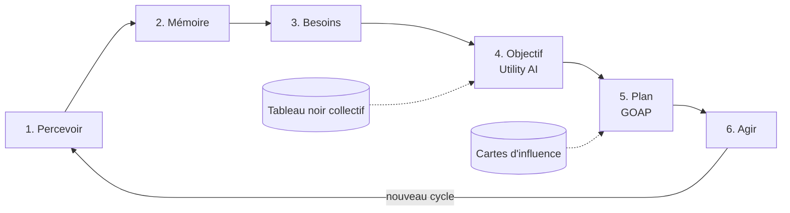

# 06 — Moteur comportemental

L'intelligence repose sur quatre couches combinées, plutôt que sur un seul « cerveau » complexe. Les stratégies sophistiquées émergent de leur combinaison et des interactions entre individus. L'IA est **symbolique et explicable** : pas d'apprentissage automatique.

## Boucle de décision



1. **Percevoir** — scanner les cases dans le rayon de perception : ressources, individus, menaces, stations.
2. **Mettre à jour la mémoire** — ajouter, renforcer ou corriger les souvenirs ; mettre à jour les cartes d'influence personnelles.
3. **Évaluer les besoins** — recalculer les jauges et leur urgence.
4. **Choisir un objectif** — Utility AI.
5. **Planifier** — GOAP : séquence d'actions qui mène à l'objectif.
6. **Agir** — exécuter l'action courante du plan, une action pouvant durer plusieurs cycles.

### Fréquence

- Perception et action : à chaque cycle.
- Réévaluation de l'objectif : tous les 10 cycles, **étalée** (individu `i` réévalue au cycle `t` si `(t + i) % 10 === 0`) pour lisser la charge.
- Réévaluation immédiate sur **interruption** : attaque subie, danger perçu, plan bloqué (précondition devenue fausse), objectif atteint.

## Couche 1 — Utility AI (choix de l'objectif)

### Objectifs candidats

| Objectif | Niveau de pyramide | Entrées principales |
| --- | --- | --- |
| Manger | Survie | Faim, nourriture connue, inventaire |
| Boire | Survie | Soif, eau connue |
| Dormir | Survie | Fatigue, nuit, abri connu |
| Fuir | Sécurité | Danger perçu, PV |
| Construire un abri | Sécurité | Pas d'abri, insécurité, nuit approchante |
| S'équiper | Équipement | Pas d'arme, dangers mémorisés |
| Fabriquer un outil | Efficacité | Recettes connues, ressources inaccessibles connues |
| Explorer | Savoir | Curiosité, zones inconnues proches |
| Expérimenter | Savoir | Curiosité, ingrédients disponibles |
| Écrire / lire | Savoir | Recettes non écrites, livres non lus |
| Se répliquer | Harmonie | Conditions remplies, demande du tableau noir |
| Tâche collective | Variable | Tâche ouverte du tableau noir adaptée à l'individu |
| Aménager | Harmonie | Score d'ordre spatial, ressources en stock |

### Calcul du score

Chaque considération `x_i` (normalisée entre 0 et 1) passe par une **courbe de réponse** (linéaire, quadratique, logistique, inverse) définie en données. Le score d'un objectif `o` est :

```
score(o) = Π courbe_i(x_i) × compensation × pyramide(o) × (1 + inertie)
```

- **Compensation** : correction du produit pour ne pas pénaliser les objectifs à nombreuses considérations (`compensation = 1 + (1 − p) × (1 − 1/n) × p`, où `p` est le produit brut et `n` le nombre de considérations).
- **Pyramide** : `pyramide(o) = Π (1 − urgence(niveau inférieur) × 0,9)` sur les niveaux inférieurs à celui de `o`. Un besoin de survie critique écrase presque tout le reste.
- **Inertie** : +0,15 pour l'objectif en cours, pour éviter les changements d'avis incessants.
- Égalité : départage par le générateur à graine (jamais par l'ordre d'itération).

Les définitions d'objectifs et de courbes sont dans `data/ai-goals.json`.

## Couche 2 — GOAP (planification)

- **État du monde simplifié** : ensemble de faits booléens ou numériques du point de vue de l'individu (`hasItem.stone_axe`, `knowsPlace.wood`, `atLocation`, `inventory.wood >= 4`).
- **Actions** : préconditions, effets, coût (en cycles estimés + risque). Exemples : `goTo(place)`, `harvest(resource)`, `craft(recipe)`, `build(structure)`, `explore(direction)`, `experiment(combo)`, `read(book)`, `sleep`.
- **Recherche** : A* à rebours depuis l'objectif, heuristique = nombre de faits non satisfaits.
- **Plafonds** : profondeur 8 actions, 500 nœuds explorés. Au-delà, le planificateur insère `explore` ou renonce et l'objectif reçoit une pénalité temporaire.
- **Information manquante** : si aucun lieu connu ne fournit une ressource nécessaire, l'action `explore` (avec une direction issue des cartes d'influence) est insérée.
- **Cache** : les plans sont mis en cache par `(objectif, signature d'état)` et partagés entre individus d'une même colonie, puis revalidés avant exécution.
- **Exécution** : une action dont la précondition devient fausse provoque une replanification.

## Couche 3 — Cartes d'influence (raisonnement spatial)

Grilles basse résolution (1 cellule = 8 × 8 cases), propres à chaque individu (construites à partir de sa mémoire) ou à la colonie (à partir du tableau noir) :

| Carte | Contenu | Usage |
| --- | --- | --- |
| Ressources | Densité de ressources connues, par type | Où récolter |
| Danger | Menaces mémorisées, avec décroissance | Où ne pas aller, où bâtir des défenses |
| Exploration | Cellules déjà vues, avec date | Frontière à explorer |
| Construction | Bâtiments et zones de la colonie | Où bâtir, spécialisation des zones |

- **Exploration** : la direction choisie maximise `valeur(cellule frontière) = inconnu × (1 − danger) / distance`.
- **Choix d'un site de construction** : maximise sécurité, proximité des ressources clés et cohérence avec la zone (habitat près de l'habitat, ateliers près des ressources).

## Couche 4 — Tableau noir collectif

Dès qu'il y a au moins deux individus apparentés, ils partagent un **tableau noir de colonie** :

- **Besoins collectifs** : stocks de la colonie, population, score d'harmonie et ses composantes.
- **Tâches ouvertes** : « récolter 20 bois pour l'entrepôt », « explorer le nord », « écrire la recette X ».
- **Réservations** : « j'exploite ce filon », pour éviter que dix individus aillent au même endroit.
- **Connaissances déposées** : lieux et dangers signalés en revenant au camp.

Règles :

- Un individu ne lit et n'écrit dans le tableau noir que lorsqu'il est **au camp** (à portée d'un bâtiment de la colonie). Le tableau noir n'est pas omniscient.
- Les tâches sont créées par des **générateurs de tâches** qui comparent l'état de la colonie à des cibles (stocks minimaux, savoir non écrit, zones à aménager).
- Un individu évalue chaque tâche ouverte comme un objectif candidat ; son score dépend de ses aptitudes (un individu fort préfère la récolte, un individu à grande mémoire préfère l'écriture).
- Les **rôles** (récolteur, bâtisseur, éclaireur, scribe) ne sont pas assignés : ils émergent et sont seulement affichés.

## Combat

- Engagement si un prédateur attaque ou si l'objectif `S'équiper`/`Chasser` le prévoit.
- Résolution simple par échanges de dégâts à chaque cycle d'adjacence (formules dans [03-individu](03-individu.md)).
- Fuite si les PV passent sous 30 % et qu'une issue existe.

## Explicabilité et débogage

- Chaque réévaluation écrit une entrée dans le journal de l'individu (voir [03-individu](03-individu.md)).
- Un mode débogage affiche, pour l'individu sélectionné, les scores de tous les objectifs et le plan en cours.
- Tests obligatoires : scénarios fixes (graine + situation) avec la décision attendue, ex. « faim 90 et baies connues à 5 cases → objectif Manger, plan goTo puis harvest puis eat ».
